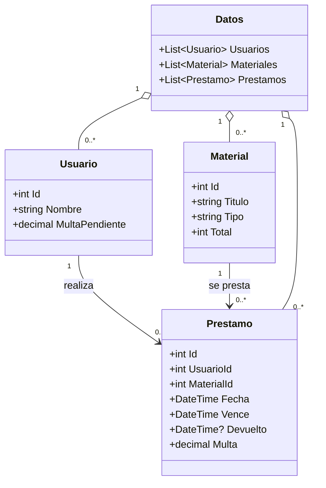

# Diagrama de clases: biblioteca

Cada préstamo guarda los identificadores del usuario y del material. `Datos` reúne las tres listas para guardarlas en un solo archivo JSON. Los libros y las revistas se distinguen mediante el campo `Tipo`. Las operaciones del menú están en `Program.cs`.
