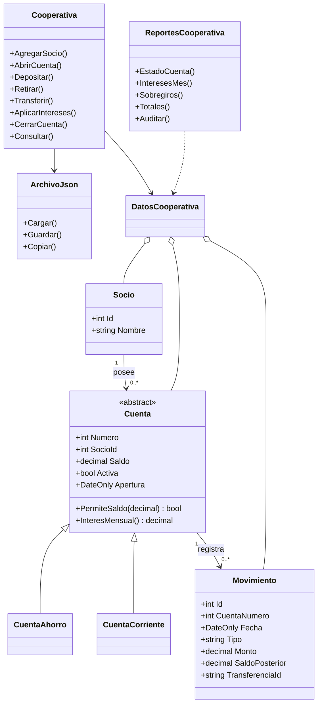

# Ejercicio 2 - Cooperativa de ahorro y crédito

Autor del aporte: Arévalo Bustamante Dany Andrés.

Aplicación de consola con socios, cuentas de ahorro y corrientes, depósitos, retiros, transferencias, intereses y cinco reportes. Usa herencia para diferenciar las cuentas y guarda la información en un archivo JSON. No usa base de datos SQL ni paquetes externos.

## Ejecutar desde la raíz del repositorio

```powershell
dotnet build Tr1-BDD-CSharp.sln
dotnet run --project src/Ejercicio02_CooperativaAhorro
```

La aplicación muestra la ruta absoluta del archivo utilizado. Sin argumentos crea sus datos locales en `bin/Debug/net10.0/datos/cooperativa.json` dentro del proyecto; esos archivos se ignoran en Git. Cada operación aceptada se guarda automáticamente. Para usar una ubicación propia:

```powershell
dotnet run --project src/Ejercicio02_CooperativaAhorro -- C:\Temp\cooperativa.json
```

Usar una sola instancia de la aplicación por archivo. No está diseñada para acceso simultáneo ni para uso bancario real.

## Probar los datos de ejemplo sin alterar el original

```powershell
Copy-Item datos-prueba/Ejercicio02_CooperativaAhorro/cooperativa-ejemplo.json "$env:TEMP\cooperativa-demo.json"
dotnet run --project src/Ejercicio02_CooperativaAhorro -- "$env:TEMP\cooperativa-demo.json"
```

Si esa copia ya existe y quieres conservarla, elige otro nombre. El ejemplo tiene socios ficticios y operaciones de octubre de 2026:

| Cuenta | Socio | Tipo | Saldo final |
| --- | --- | --- | --- |
| 101 | Ana Torres | Ahorro | $80,27 |
| 102 | Ana Torres | Corriente | -$30,00 |
| 201 | Luis Mina | Ahorro | $301,00 |

En el menú 9 se consultan los cinco reportes. Para octubre de 2026 los depósitos suman $420,00; los retiros $70,00; los intereses acreditados suman $1,27. La transferencia de $20 aparece en ambos totales, como pide el registro retiro/depósito. La auditoría debe indicar que las tres cuentas son correctas.

## Decisiones para interpretar el enunciado

- Las cuentas se abren en cero, sin saldo inicial oculto. Una cuenta de ahorro en cero está pendiente de su primer depósito, que debe alcanzar al menos $5; después ningún retiro ni transferencia puede bajarla de $5. Esto permite registrar también cuentas todavía no financiadas.
- Una cuenta con saldo distinto de cero no se cierra. Si está en cero y tiene movimientos, se conserva inactiva; si no tiene movimientos se elimina. El enunciado no da una excepción para retirar los últimos $5 de ahorro al cerrar: no se implementó una liquidación especial y se debe consultar al docente si la requiere.
- Las transferencias se hacen entre cuentas distintas del mismo socio. Se validan origen, destino, monto y fechas antes de guardar el estado completo. Si algo falla, no se conserva ninguna de las dos operaciones.
- El interés mensual usa el saldo al terminar el mes: `saldo * 0.04 / 12`. Se redondea a dos decimales, con mitades hacia arriba. Se acredita al último día del mes y solo una vez por cuenta y mes. No se usa saldo promedio diario porque no lo pide el enunciado.
- Los movimientos deben estar en orden de fecha por cuenta. Después de aplicar intereses no se admiten nuevos movimientos de esa cuenta con fecha del mes cerrado; se usa una fecha posterior. Se deben registrar primero todas las operaciones y luego aplicar intereses.
- Un abono de interés cero también queda registrado para evitar una segunda aplicación del mismo mes. Los intereses no se cuentan como depósitos en el reporte de totales.
- Los períodos incluyen las fechas inicial y final. El estado de cuenta conserva el saldo después de cada movimiento. La auditoría recalcula desde cero y compara tanto el saldo final como los saldos posteriores guardados.
- Los montos monetarios usan `decimal`, deben ser positivos para depósitos/retiros/transferencias y tener como máximo dos decimales. En consola se acepta punto o coma decimal, sin separadores de miles.
- Un JSON ilegible produce un error y no se reemplaza por uno vacío. El guardado usa un archivo temporal en la misma carpeta y luego reemplaza el archivo principal.

## Pruebas reproducibles

```powershell
dotnet run --project pruebas/Ejercicio02_CooperativaAhorro -- pruebas/Ejercicio02_CooperativaAhorro/RESULTADOS.md
```

Es un programa de pruebas de consola sin dependencias adicionales; no se ejecuta con `dotnet test`. Devuelve código 0 si todos los casos pasan y código 1 si alguno falla. Los casos crean sus propios archivos temporales, comprueban resultados y los eliminan al finalizar. `RESULTADOS.md` contiene la tabla de resultados reales de la última ejecución; no se debe editar para aparentar que una prueba pasó.

## Organización del código

Los modelos están separados en `Socio.cs`, `Cuenta.cs`, `CuentaAhorro.cs`, `CuentaCorriente.cs`, `Movimiento.cs` y `DatosCooperativa.cs`, como los modelos de los ejercicios 3 y 4. Los métodos usan bloques con llaves y cada instrucción ocupa su propia línea. Las altas de socios y movimientos se realizan creando un objeto y asignando sus propiedades paso a paso.

`Servicios/Cooperativa.cs` contiene las operaciones; `Persistencia/ArchivoJson.cs`, la lectura y escritura; `Reportes/ReportesCooperativa.cs`, las consultas; y `Program.cs`, el menú. Cada operación trabaja sobre una copia de los datos y solo la conserva después de guardar: así una transferencia fallida no modifica ninguna cuenta.

## Diagrama de clases

- [Ver el diagrama](../../documentacion/diagramas-de-clases/Ejercicio02.svg).
- [Diagrama editable en diagrams.net](../../documentacion/diagramas-de-clases/Ejercicio02.drawio).

El dibujo muestra los modelos principales y las clases de servicio, persistencia y reportes. Las clases auxiliares `InteresCuenta`, `TotalesPeriodo` y `AuditoriaCuenta` representan los resultados de los reportes.



## Documentación para el grupo

El informe de este ejercicio está en `documentacion/informe/Arevalo-Bustamante-Tr1-Ejercicio02.pdf`. La bitácora está en `documentacion/informe/Bitacora-IA-Ejercicio02.md`. El grupo debe integrar los otros cuatro ejercicios, revisar el compromiso 7 del sílabo (no proporcionado) y generar el informe final `Apellidos-Tr1.pdf` antes de subirlo al portafolio. Este aporte no sustituye la entrega grupal completa.
